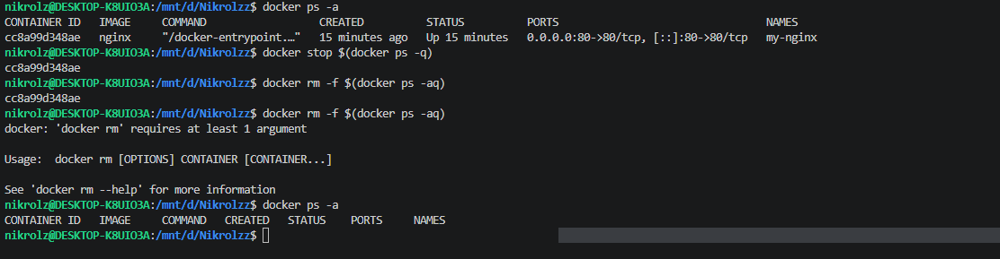
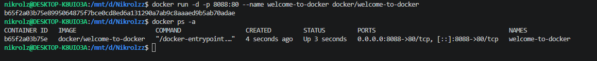
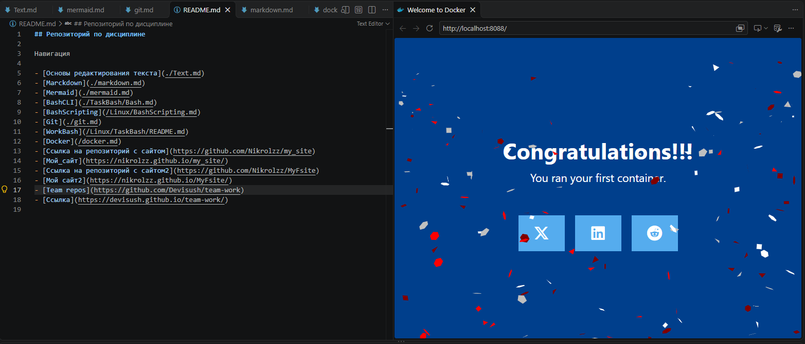
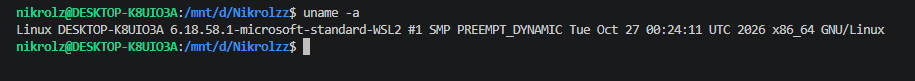
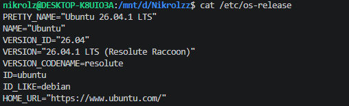
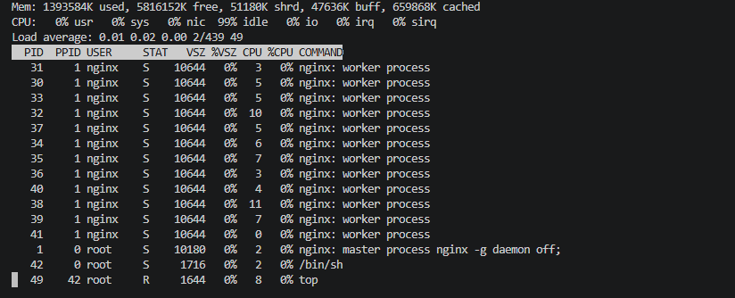
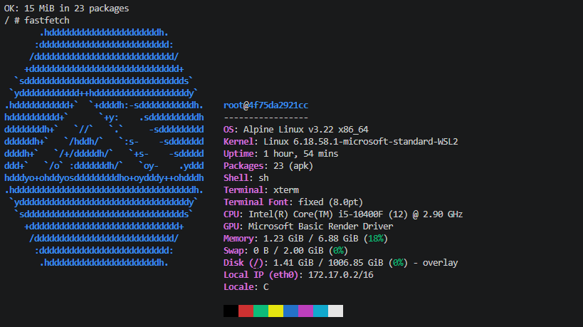

## Welcome to Docker

## 1. Подготовка

Остановил все запущенные контейнеры, удалил остальные и почистил неиспользуемые тома:

```shell
docker ps -a
docker stop $(docker ps -q)
docker rm -f $(docker ps -aq)
docker volume prune -f
docker ps -a
```

Контейнеров не осталось.



## 2. Проверка порта 8088 и запуск контейнера
Создал и запустил контейнер из образа `docker/welcome-to-docker`, порт 8088 хоста пробросил на порт 80 контейнера:

```shell
docker run -d -p 8088:80 --name welcome-to-docker docker/welcome-to-docker
docker ps
```



Открыл http://localhost:8088 в браузере, страница приветствия работает:




## 4. Работа внутри контейнера

Зашёл в контейнер.

```shell
docker exec -it welcome-to-docker /bin/sh
```

Информация об ОС:

```shell
uname -a
cat /etc/os-release
```





Диспетчер ресурсов `top`. Внутри контейнера работают только процессы Nginx (мастер и воркеры):

```shell
top
```




Запустил `fastfetch`:

```shell
fastfetch
```



Выход из контейнера: `exit`.