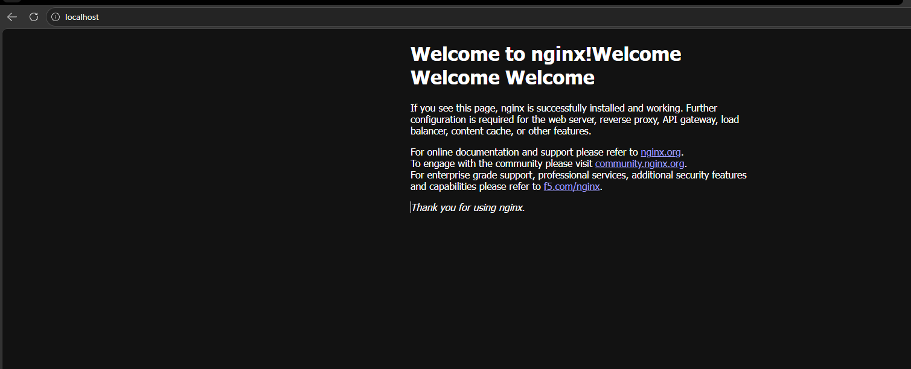

## Лабораторная работа: готовый образ Nginx в Docker

## 1. Проверка Docker

Проверил, что Docker установлен, и посмотрел его версию:

```shell
docker version
```

## 2. Подготовка (чистый лист)

Посмотрел, какие контейнеры уже есть, остановил их и удалил остановленные:

```shell
docker ps -a
docker stop $(docker ps -q)
docker container prune -f
docker ps -a
docker images
```
После очистки контейнеров не осталось.


## 3. Получение образа Nginx и запуск контейнера

Нашёл образ на Docker Hub:

```shell
docker search nginx
```


Запустил контейнер. `docker run` сам скачал образ, создал и запустил контейнер:

```shell
docker run -d --name my-nginx -p 80:80 nginx
docker ps -a
```

Запуск контейнера


## 4 Управление контейнером
Лог контейнера (видны запуск воркеров и мои запросы к серверу):

```shell
docker logs my-nginx
```


### Работа внутри контейнера

Зашёл в контейнер:

```shell
docker exec -it my-nginx bash
```

Информация об ОС:

```shell
uname -a
cat /etc/os-release
```


Установил несколько программ:

```shell
apt update && apt install -y fastfetch htop inxi cmatrix hollywood caca-utils mc micro
```

Во время установки одна из программ спросила выбор, я выбрал английскую (`1`):


`fastfetch` показывает сводку о системе:

```shell
fastfetch
```


`htop` показывает процессы (видно мастер-процесс nginx и его воркеры):

```shell
htop
```


`cmatrix`:

```shell
cmatrix
```


`cacafire`:

```shell
cacafire
```


`hollywood` запускает сразу несколько окон в tmux (atop, bmon, логи и другое):

```shell
hollywood
```


## 5. Редактирование страницы Nginx

